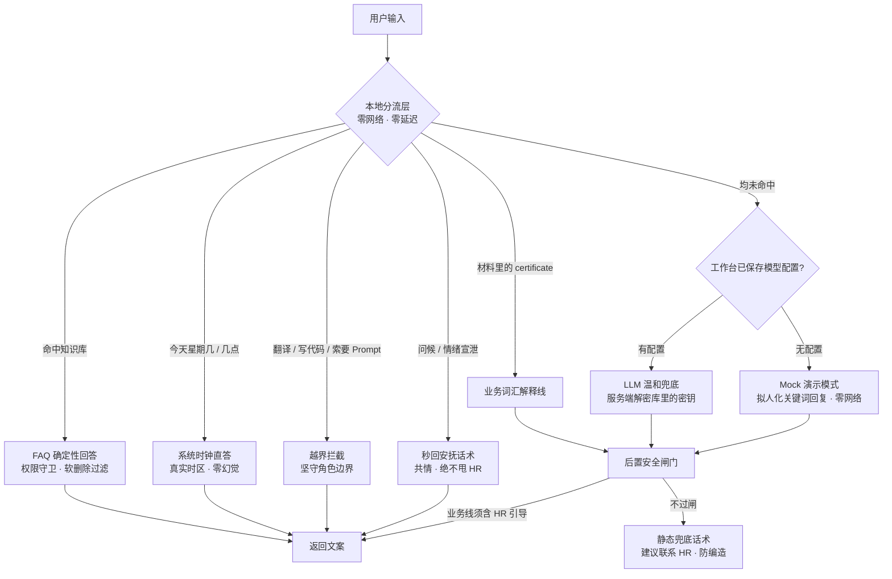

# HR-Onboarding-Agent（小初 · 企业级新员工入职咨询助理）

> 让每个新员工在入职第一天，就有一个永远在线、绝不胡说八道的 AI 同事。

> **目录口径（2026-11-13 起）**：按 `chujian.txt` 规则 8，运行时项目整体位于 `onboard/` 子目录。
> 本文提到的「项目根」一律指 `onboard/`；**所有 `npm` / `npx prisma` / `docker compose` 命令都要先进入 `onboard/` 再执行**。
> 工作区根目录只保留留档：`AGENTS.md`、`PROGRESS.md`、`chujian.txt`、`系统prompt汇总.md`、`TEST_LOG.md`、`docs/`。
> 数据库落在 `onboard/data/`（相对 `onboard/prisma/schema.prisma` 即 `../data`），环境变量文件在 `onboard/.env`。

「小初」是一个**开箱即用**的新员工入职咨询 Agent：报到流程、材料清单、社保公积金、找人对接——能查到就秒答，查不到绝不编造。全部回答被确定性规则与多重安全闸门约束，LLM 只在本地层未命中的尾部流量里温柔兜底。

- 前台：Next.js 15 App Router 聊天界面（游客即用，注册无缝升级不丢记录）
- 管理后台 `/admin`：数据看板 / 对话审查 / 知识库管理 / 用户管理
- 开发者后台 `/developer`：系统诊断 + System Prompt 只读预览
- 数据：SQLite + Prisma（零外部服务依赖，`data/` 即全部状态）

---

## 核心架构

一次提问的完整数据流——**确定性的归本地，不确定的才给 LLM**：



## 四大核心亮点

### 1. 确定性与 LLM 混合架构

本地分流层（问候 / 情绪 / 越界 / 时间 / 词汇解释 / FAQ 检索）处理掉绝大多数输入，**48ms 级本地秒回**——比 LLM 快两个数量级，Token 消耗趋近于零。LLM 只兜底真正的长尾问题，且回答必须过后置闸门：业务问题强制携带「联系 HR」引导，从机制上杜绝编造政策。

### 2. 三重降级策略，断网不崩

| 故障场景 | 行为 |
|---|---|
| 工作台没保存模型配置 | 自动进入 **[本地演示模式]**，拟人化 Mock 回复，无需任何密钥即可体验完整交互 |
| 密钥解密失败 / 查库失败 / 上游超时 | 一律降级，调用方回退静态兜底话术，不阻断对话 |
| LLM 输出越界 / 编造 | 后置闸门拦截，替换为安全话术 |

任何一层失手都有下一层接住——用户永远能看到一条得体的回复。

### 3. 顶级安全防御

- **红蓝对抗 15/15 全 PASS**：提示词窃取 / 上下文污染 / 角色劫持 / Prompt 索要 / 解除限制五维度（`scripts/security-test.mjs` 可随时重放）
- **权限纵深防御**：middleware（edge 体验层）→ 页面层验签 → API 层 `requireAdmin` / `requireDeveloper` 三级拦截；JWT role 快照 + SQLite 无 enum 白名单归一化
- **角色边界禁令**：Prompt 层硬约束——非入职请求统一礼貌拒绝，绝不执行翻译/计算，绝不触发「联系 HR」兜底
- **数据安全**：`.env*` / `*.db` / 日志全部隔离出仓库；账号密码 bcrypt；HttpOnly Cookie

### 4. Vibe Coding 开发范式

本项目是 **AI 协作开发**的完整样本：产品意图由人拍板，编码、测试、审查、安全红队、文档全部由 AI Agent 与人多轮协同完成——线性提交、203 条测试全绿、0 lint 警告，每一轮都以「实测输入 → 修复 → 回归」闭环收束。欢迎用它作为 AI 工程化协作的参考实现。

---

## 快速开始

以下命令**都在 `onboard/` 目录下执行**：

```bash
cd onboard                 # 从工作区根目录进入运行时项目
npm install
npx prisma db push        # 建表（SQLite，零外部依赖）
npm run dev               # http://localhost:3000
```

打开 <http://localhost:3000/workspace>：首次使用按页面提示创建工作空间与管理员账号，之后用「员工登录」进入。
示例账号与密码见 `samples/示例账号清单.csv`（相对 `onboard/`）；`/workspace/assistant` 是员工服务助手。

> **不配任何密钥也能玩**：工作台没保存模型配置时，系统自动进入 [本地演示模式]，无需配置即可体验完整交互。

启用真实 LLM：在 `/workspace/model-config` 填接口地址、模型名称与密钥；密钥用 AES-256-GCM 加密存库，页面只提示「已加密保存」，绝不回显。
`.env*` 里的 `DEEPSEEK_*` / `GLM_*` 只对 vitest 兼容用例生效，development / production 不读取。

### 管理后台

```bash
npm run gen-password -- 你想用的口令 --write   # 生成 ADMIN_PASSWORD_HASH 写入 .env.local
```

访问 <http://localhost:3000/admin>（口令登录）；开发者后台 `/developer` 仅对 `DEVELOPER` 角色开放：

```bash
npm run promote-admin -- <邮箱或userId> [USER|ADMIN|DEVELOPER]   # 默认提为 ADMIN
```

## 回归与检查

以下命令同样**都在 `onboard/` 目录下执行**：

```bash
npm run verify         # tsc --noEmit + vitest run（203 条全绿）
npm test               # 只跑 vitest
npm run lint           # ESLint 9 flat config，0 error 0 warning 才收工
npm run format:check   # Prettier 全绿
npm run llm:e2e        # 模型配置真库闭环（离线）
npm run workspace:e2e  # 助手 / 检索端到端（需先起 dev）
```

> 改文案 / 守卫 / 知识条目后，`verify` + `lint` 全绿才算完成。

## 技术栈

Next.js 15（App Router）· React 19 · Tailwind CSS 3 · Prisma + SQLite · jose（JWT）· OpenAI 兼容接口（工作台加密配置）· Vitest

## License

[MIT](./LICENSE)
